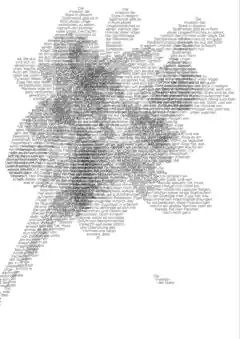

# 11 可视化文本型信息图形（Visualized Text）

> **证据边界**：本说明以用户上传的《第三讲—信息图形类型学(2).pdf》第 32 页作为图像观察来源；课件截图能支持图形构成与版式描述，但未经原始作品/数据验证的作者、数值与效果均不作为事实。

## 课件图例的可见特征

左图以大量品牌名/标志和圆形群组进行视觉聚合，右图围绕“品牌流程”核心词展开环形关系。

## A. 数据逻辑与最小结构

信息单元是`文本词项｜语义关系｜频次/权重(可选)｜解释`；文字既是内容，也是图形元素。

## B. 借用的统计图形与计算方式

只有绑定实际词频或度量时才可用词云、词条面积；流程词图可映射关系但不自动代表数量。

## C. 视觉编码（点、线、面、体、符号、色彩与排版）

字重、字号、色彩、位置和环绕路线组织阅读；大字可能是视觉标题而非统计权重。

## D. 数据／信息架构

核心概念→语义类群→关系链→注释，保留文本原义及字词边界。

## E. 视觉叙事架构

视觉中心提示主题→组群联想→按路径发现关系→返回摘要；兼顾文字可读与视觉节奏。

## B 项补充：词云的统计边界

- 只有在词项来自明确语料、经过分词/清洗，并将词频或其他权重映射到字号、面积等视觉变量时，才可称为具有定量含义的统计词云。
- CASE-0017 与 CASE-0018 均未见词频表、权重刻度或图例；因此目前只记录为“词云式文字构形”，不能据文字大小、重复密度或空间占比推断词频、重要性或情绪强度。
- 若后续获得原始语料与制作规则，再补充词项提取、停用词处理、权重计算和尺寸映射方法。

## 用户新增案例观察：词云式文字构形

### CASE-0017｜文字轮廓构形（用户上传图片1）

**观察事实**
- 德文连续文本被重复排布、叠置，形成多个相互连接的文字密集区域。
- 字体整体以灰黑色为主，字号差异并不构成可验证的数量刻度；文字块的外缘轮廓承担主要造型作用。
- 局部文字重叠明显，视觉上先读到整体形状，再尝试辨认单词与句子。

**分析判断**
- 主表现类型：可视化文本型；次级表现：文字图形化 / 轮廓构形。
- 数据逻辑：暂不判定。画面未提供词项清单、语料范围、词频或权重定义。
- 不应仅因文字密集和大小不一，就把它认定为按词频编码的统计词云。

**可借鉴方法**
- 可先确定目标轮廓，再沿轮廓或区域填入具有主题关联的文本；需要控制重叠率、字距和留白，确保形状与可读性之间的平衡。
- 若目标是统计词云，应另外建立词频数据和明确的尺寸映射，不能用装饰性排字替代数据编码。

### CASE-0018｜文字路径构形（用户上传图片2）

**观察事实**
- 黑色与红色英文短句沿弧线、带状路径和局部聚集区排列，文字方向随路径发生旋转。
- 不同文字流在画面中心交叠，形成具有方向感的整体图形；红黑对比强化了不同文字群之间的视觉区分。
- 画面未见词频图例、权重标尺或语义颜色说明。

**分析判断**
- 主表现类型：可视化文本型；次级表现：文字路径构形 / 文字图像。
- 数据逻辑：暂不判定。颜色、方向与密度目前只能作为可见形式描述，不能推断其代表情绪、阵营或统计量。
- 该案例更接近沿路径组织的文字造型，不足以证明其为词频驱动的传统词云。

**可借鉴方法**
- 可将文字沿曲线、轮廓或方向轴排布，通过字号、旋转角度、颜色和密度建立阅读节奏。
- 需保留足够的字间距与方向一致性；若多组文字交叉，应提供清晰的起点、终点或分组提示。

## 案例验证记录

| CASE ID | 可观察特征 | 可支持的判断 | 当前不能推断 |
| --- | --- | --- | --- |
| CASE-0017 | 连续文本叠置并形成轮廓 | 文字作为图形材料；轮廓优先 | 词频、权重、语义重要性 |
| CASE-0018 | 文字沿弧形路径与带状区域排布 | 文字路径、方向与颜色组织视觉层次 | 词频、情绪、群体含义 |

以上为单例观察，不直接升级为通用设计原则。

## 边界与待核实事项

词项尺寸若无图例，不能推断比例；图像右侧看似流程，也可能是概念关系图。

## 与五种数据逻辑的连接

- [编目型数据逻辑](../01-信息图形数据逻辑/03-编目型信息图形概念定义.md)
- [层级型数据逻辑](../01-信息图形数据逻辑/02-层级型信息图形概念定义.md)

[课件分类核验与页码索引](课件来源与分类核验.md) · [案例索引](案例索引.md) · [案例分析模板](案例分析模板.md)

## 修订记录

- 2026-11-19 · v0.2.0 · 根据课件第 32 页的可见图例补写 A–E；保留待核验项目。\n- 2026-11-23 · v0.3.0 · 增补 CASE-0017、CASE-0018 两个用户上传的词云式文字构形案例；明确词频与权重证据边界。
