# 案例索引：课件示例

当前已登记16条课件页内示例观察记录（非16张独立高清原作）。图例图片来自用户上传的课件，原作品版权和数据口径尚待核验；本次补充CASE-0017与0018参考案例，下一件独立案例从CASE-0019编号。

| 图例缩略图 | ID | 来源页 | 案例 | 主要逻辑 | 主要表现 |

| --- | --- | --- | --- | --- | --- |

| 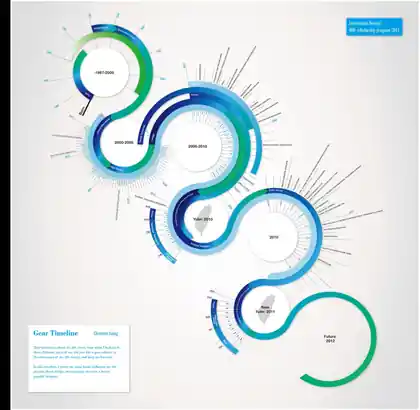 | [CASE-0001](03-时间轴型-Timeline/案例/CASE-0001-编年曲线/分析.md) | 3 | 编年曲线 | 编年 | [类型](03-时间轴型-Timeline/00-标签说明.md) |

|  | [CASE-0002](09-层级表现型-Hierarchical/案例/CASE-0002-进化层级图/分析.md) | 6 | 进化层级图 | 层级 | [类型](09-层级表现型-Hierarchical/00-标签说明.md) |

| 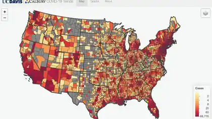 | [CASE-0003](07-地标型-Location/案例/CASE-0003-美国疫情地图/分析.md) | 9 | 美国疫情地图 | 地理 | [类型](07-地标型-Location/00-标签说明.md) |

| 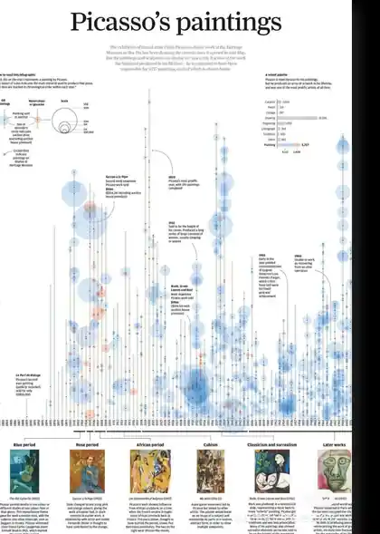 | [CASE-0004](01-混合型-Mixed-Charts/案例/CASE-0004-绘画编目/分析.md) | 11 | 绘画编目 | 编目 | [类型](01-混合型-Mixed-Charts/00-标签说明.md) |

| 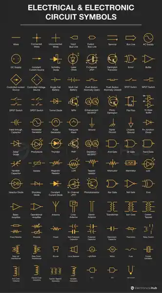 | [CASE-0005](02-文字型列表型-Informational-List/案例/CASE-0005-电路符号图鉴/分析.md) | 14 | 电路符号图鉴 | 编目 | [类型](02-文字型列表型-Informational-List/00-标签说明.md) |

|  | [CASE-0006](07-地标型-Location/案例/CASE-0006-城市空间规划图/分析.md) | 17 | 城市空间规划图 | 地理 | [类型](07-地标型-Location/00-标签说明.md) |

| 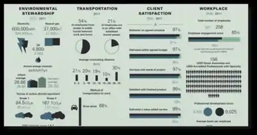 | [CASE-0007](01-混合型-Mixed-Charts/案例/CASE-0007-多主题混合统计/分析.md) | 22 | 多主题混合统计 | 编目 | [类型](01-混合型-Mixed-Charts/00-标签说明.md) |

| 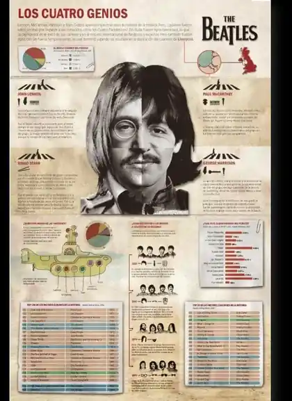 | [CASE-0008](02-文字型列表型-Informational-List/案例/CASE-0008-人物文字列表/分析.md) | 23 | 人物文字列表 | 编目 | [类型](02-文字型列表型-Informational-List/00-标签说明.md) |

| 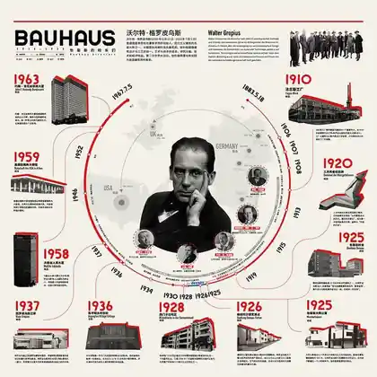 | [CASE-0009](03-时间轴型-Timeline/案例/CASE-0009-包豪斯时间轴/分析.md) | 24 | 包豪斯时间轴 | 编年 | [类型](03-时间轴型-Timeline/00-标签说明.md) |

|  | [CASE-0010](04-示意图型-How-to/案例/CASE-0010-分层三明治/分析.md) | 25 | 分层三明治 | 层级 | [类型](04-示意图型-How-to/00-标签说明.md) |

|  | [CASE-0011](05-流程图型-Process/案例/CASE-0011-城市流程路线/分析.md) | 26 | 城市流程路线 | 编年 | [类型](05-流程图型-Process/00-标签说明.md) |

| 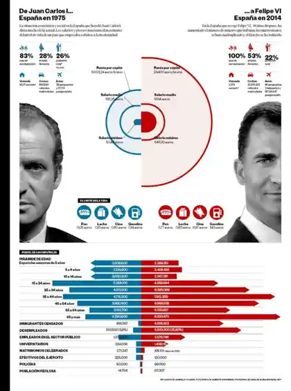 | [CASE-0012](06-比较型-Comparison/案例/CASE-0012-体育人物比较/分析.md) | 27 | 体育人物比较 | 编目 | [类型](06-比较型-Comparison/00-标签说明.md) |

| 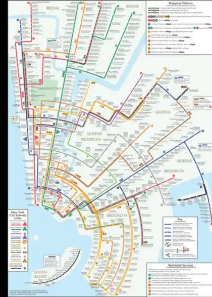 | [CASE-0013](07-地标型-Location/案例/CASE-0013-轨道交通网络/分析.md) | 28 | 轨道交通网络 | 地理 | [类型](07-地标型-Location/00-标签说明.md) |

| 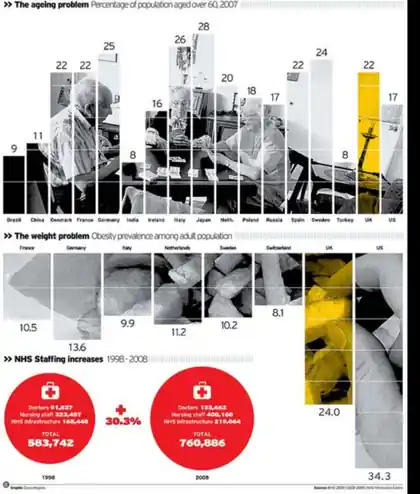 | [CASE-0014](08-图片式-Photo-graphic/案例/CASE-0014-摄影嵌入图表/分析.md) | 29 | 摄影嵌入图表 | 编年 | [类型](08-图片式-Photo-graphic/00-标签说明.md) |

| 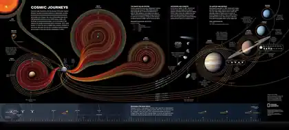 | [CASE-0015](15-编年编目复合型-Hybrid/案例/CASE-0015-宇宙旅程混合图/分析.md) | 37 | 宇宙旅程混合图 | 编年 | [类型](15-编年编目复合型-Hybrid/00-标签说明.md) |

| 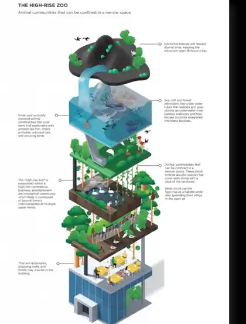 | [CASE-0016](16-三维型-3D/案例/CASE-0016-轴测分层生态图/分析.md) | 38 | 轴测分层生态图 | 层级 | [类型](16-三维型-3D/00-标签说明.md) |

**注意**：这些CASE仅供基于课件的视觉观察，不代表可独立验证的数据案例；用户以后提供高清原作则在原CASE增补来源、版权、作者、数据与反例。已按课件对应页提取并保存16张研究缩略图；其原作品授权尚未核实，再转载或商用前应取得许可。五份数据逻辑文档只留文字链接。

[课件核验](课件来源与分类核验.md) · [方法指南](信息图形研究方法与质量评估.md) · [案例模板](案例分析模板.md)

## 跨类型的基础设计方式标签

[ISOTYPE](../03-ISOTYPE信息图/00-ISOTYPE概念与方法.md) 是独立的方法标签，不计入表现类型数量。登记案例时可写“数据逻辑：编目；表现类型：比较型；基础设计方式：ISOTYPE 方法借鉴”，并注明证据与待核事项。此组合仅为填写示例，不表示已有案例已核实采用此方法；当前不批量修改原有CASE分类。

## CASE-0017 Fortune500都市圈营收分布

参考库导入研究记录，主逻辑为地理。

[案例](07-地标型-Location/案例/CASE-0017-Fortune500都市圈营收分布/README.md) · [来源](https://github.com/fengbaifan/Infographic-Style-Repository/tree/111a6b42c7f6da436a5ad1ab82b9a40557f365dc/02-信息图形类型案例/07-地标型-Location/案例/CASE-0001-Fortune500都市圈营收分布)。

## CASE-0018 Our-Process-曲线流程信息图

参考库导入研究记录，主逻辑为编年。

[案例](05-流程图型-Process/案例/CASE-0018-Our-Process-曲线流程信息图/README.md) · [来源](https://github.com/fengbaifan/Infographic-Style-Repository/tree/111a6b42c7f6da436a5ad1ab82b9a40557f365dc/02-信息图形类型案例/05-流程图型-Process/案例/CASE-0002-Our-Process-曲线流程信息图)。
