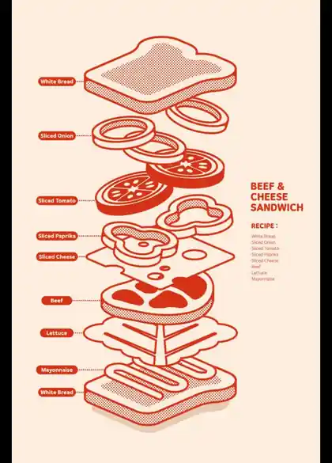
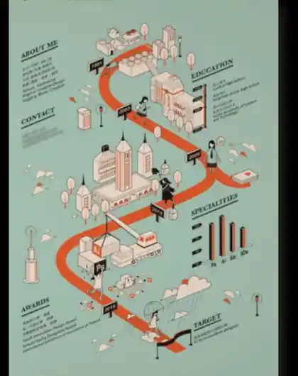
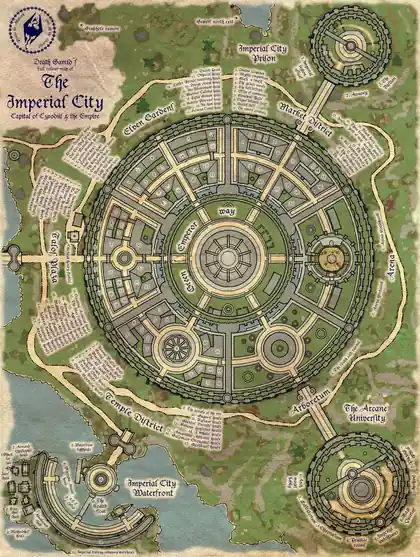
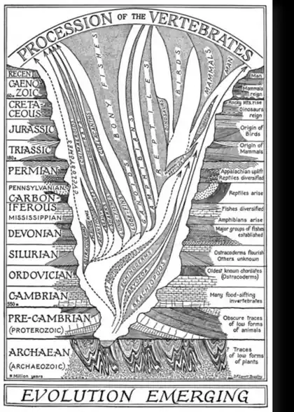

# 案例索引：按表现类型归档

当前登记 **18 条案例观察记录**：其中 CASE-0001–CASE-0016 为用户课件中的页内示例观察，CASE-0017–CASE-0018 为用户新增的词云式文字构形案例。索引按 16 种表现类型排序；原 CASE ID 与课件页码保持不变。

> 证据边界：课件缩图只支持可见形式的初步分析，不等于取得原作品高清源文件或独立核验其数据。新增词云图为用户提供的图片；目前未见词频表、权重映射或图例，因此先按“可视化文本型 / 文字构形”记录，不将字号或文字密度解释为词频。

## 01 混合型信息图形（Mixed Charts）

| 图例缩略图 | ID | 来源 | 案例 | 主要逻辑 | 主要表现 |
| --- | --- | --- | --- | --- | --- |
|  | [CASE-0004](案例记录/CASE-0004-绘画编目.md) | 课件第11页 | 绘画编目 | 编目 | [类型说明](01-混合型信息图形-Mixed-Charts.md) |
|  | [CASE-0007](案例记录/CASE-0007-多主题混合统计.md) | 课件第22页 | 多主题混合统计 | 编目 | [类型说明](01-混合型信息图形-Mixed-Charts.md) |

## 02 文字型与列表型信息图形（Informational / List）

| 图例缩略图 | ID | 来源 | 案例 | 主要逻辑 | 主要表现 |
| --- | --- | --- | --- | --- | --- |
|  | [CASE-0005](案例记录/CASE-0005-电路符号图鉴.md) | 课件第14页 | 电路符号图鉴 | 编目 | [类型说明](02-文字型与列表型信息图形-Informational-List.md) |
|  | [CASE-0008](案例记录/CASE-0008-人物文字列表.md) | 课件第23页 | 人物文字列表 | 编目 | [类型说明](02-文字型与列表型信息图形-Informational-List.md) |

## 03 时间轴型信息图形（Timeline）

| 图例缩略图 | ID | 来源 | 案例 | 主要逻辑 | 主要表现 |
| --- | --- | --- | --- | --- | --- |
|  | [CASE-0001](案例记录/CASE-0001-编年曲线.md) | 课件第3页 | 编年曲线 | 编年 | [类型说明](03-时间轴型信息图形-Timeline.md) |
|  | [CASE-0009](案例记录/CASE-0009-包豪斯时间轴.md) | 课件第24页 | 包豪斯时间轴 | 编年 | [类型说明](03-时间轴型信息图形-Timeline.md) |

## 04 示意图型（How-to）

| 图例缩略图 | ID | 来源 | 案例 | 主要逻辑 | 主要表现 |
| --- | --- | --- | --- | --- | --- |
|  | [CASE-0010](案例记录/CASE-0010-分层三明治.md) | 课件第25页 | 分层三明治 | 层级 | [类型说明](04-示意图型-How-to.md) |

## 05 流程图型（Process）

| 图例缩略图 | ID | 来源 | 案例 | 主要逻辑 | 主要表现 |
| --- | --- | --- | --- | --- | --- |
|  | [CASE-0011](案例记录/CASE-0011-城市流程路线.md) | 课件第26页 | 城市流程路线 | 编年 | [类型说明](05-流程图型-Process.md) |

## 06 比较型（Comparison）

| 图例缩略图 | ID | 来源 | 案例 | 主要逻辑 | 主要表现 |
| --- | --- | --- | --- | --- | --- |
|  | [CASE-0012](案例记录/CASE-0012-体育人物比较.md) | 课件第27页 | 体育人物比较 | 编目 | [类型说明](06-比较型-Comparison.md) |

## 07 地理型（Geographic / Location）

| 图例缩略图 | ID | 来源 | 案例 | 主要逻辑 | 主要表现 |
| --- | --- | --- | --- | --- | --- |
|  | [CASE-0003](案例记录/CASE-0003-美国疫情地图.md) | 课件第9页 | 美国疫情地图 | 地理 | [类型说明](07-地标型-Location.md) |
|  | [CASE-0006](案例记录/CASE-0006-城市空间规划图.md) | 课件第17页 | 城市空间规划图 | 地理 | [类型说明](07-地标型-Location.md) |
|  | [CASE-0013](案例记录/CASE-0013-轨道交通网络.md) | 课件第28页 | 轨道交通网络 | 地理 | [类型说明](07-地标型-Location.md) |

## 08 图片式（Photographic）

| 图例缩略图 | ID | 来源 | 案例 | 主要逻辑 | 主要表现 |
| --- | --- | --- | --- | --- | --- |
|  | [CASE-0014](案例记录/CASE-0014-摄影嵌入图表.md) | 课件第29页 | 摄影嵌入图表 | 编年 | [类型说明](08-图片式-Photographic.md) |

## 09 层级表现型（Hierarchical）

| 图例缩略图 | ID | 来源 | 案例 | 主要逻辑 | 主要表现 |
| --- | --- | --- | --- | --- | --- |
|  | [CASE-0002](案例记录/CASE-0002-进化层级图.md) | 课件第6页 | 进化层级图 | 层级 | [类型说明](09-层级表现型-Hierarchical.md) |

## 10 单一图表型（Single Chart）

暂无已登记的独立主分类案例。

## 11 可视化文本型（Visualized Text）

| 图例缩略图 | ID | 来源 | 案例 | 主要逻辑 | 主要表现 |
| --- | --- | --- | --- | --- | --- |
|  | [CASE-0017](11-可视化文本型-Visualized-Text.md#case-0017-文字轮廓构形) | 用户上传图片1 | 词云式文字轮廓构形 | 待核实 | [类型说明](11-可视化文本型-Visualized-Text.md) |
|  | [CASE-0018](11-可视化文本型-Visualized-Text.md#case-0018-文字路径构形) | 用户上传图片2 | 词云式文字路径构形 | 待核实 | [类型说明](11-可视化文本型-Visualized-Text.md) |

## 12 解剖剖析型（Anatomical）

暂无已登记的独立主分类案例。

## 13 可视化简历型（Visual Resume）

暂无已登记的独立主分类案例。

## 14 手稿型（Sketch）

暂无已登记的独立主分类案例。

## 15 编年编目混合型（Chronological × Catalog）

| 图例缩略图 | ID | 来源 | 案例 | 主要逻辑 | 主要表现 |
| --- | --- | --- | --- | --- | --- |
|  | [CASE-0015](案例记录/CASE-0015-宇宙旅程混合图.md) | 课件第37页 | 宇宙旅程混合图 | 编年 | [类型说明](15-编年编目混合图-Chronological-Catalog.md) |

## 16 三维信息图形（3D Infographics）

| 图例缩略图 | ID | 来源 | 案例 | 主要逻辑 | 主要表现 |
| --- | --- | --- | --- | --- | --- |
|  | [CASE-0016](案例记录/CASE-0016-轴测分层生态图.md) | 课件第38页 | 轴测分层生态图 | 层级 | [类型说明](16-三维信息图形-3D.md) |

## 说明与维护

- 索引按表现类型 01–16 排序；同一类型内按 CASE ID 升序排列。
- CASE ID 全局唯一且不可因重新分类而更改；辅助类型通过类型说明文档中的交叉引用记录，不重复计数。
- CASE-0001–CASE-0016 为课件页内观察；CASE-0017–CASE-0018 为用户上传的文字构形图。新案例从 CASE-0019 起。
- CASE-0017/0018 暂按可视化文本型归档。由于没有词频、权重或语义分组图例，暂不把文字大小解释为词频，也不将其当作已验证的统计词云。
- 课件缩图来自用户上传课件，原作品授权未核实；再次转载或商用前需取得许可。

[课件核验](课件来源与分类核验.md) · [方法指南](信息图形研究方法与质量评估.md) · [案例模板](案例分析模板.md) · [案例记录规范](案例记录/README.md)
