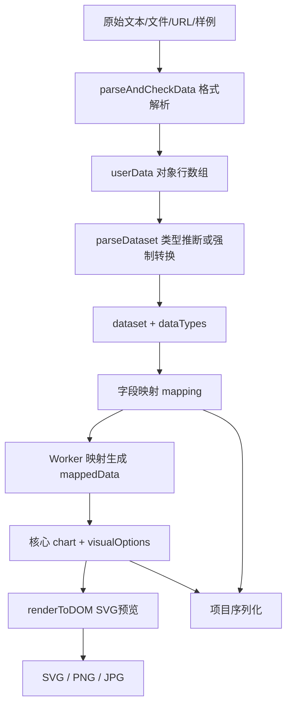

# RAWGraphs：源码架构与图形生成流程

来源快照：`48c3b2ee9ff412721a2c99c7bed38e734b3fa534`；研究日期：2026-11-23。下文“事实”指应用层源码；“建议/风险”指静态阅读推论，未经运行复现。

## 真实目录与职责

| 路径 | 已核实职责 |

| --- | --- |

| package.json、package-lock.json | 声明依赖、脚本与锁文件；应用名 rawgraphs-frontend，版本字段 2.1.0 |

| index.html、src/index.jsx、src/App.js | 页面入口与 React 应用编排；App 持有图表、映射、参数、输出实例状态 |

| src/charts.js | 从图表依赖包导入并注册 32 个图表项 |

| src/components/DataLoader/、ParsingOptions/、DataGrid/ | 输入入口、解析设置与表格编辑界面 |

| src/hooks/useDataLoader.js、useDataLoaderUtils/ | 输入状态、类型转换、替换数据检查及宽长表变换 |

| src/components/DataMapping/ | react-dnd 拖拽字段及映射提交 |

| src/components/ChartPreviewWIthOptions/ | 先计算 mappedData，再组织参数与预览；路径中的 WI 大小写沿用原仓库 |

| src/components/ChartOptions/ | 根据图表参数定义生成分组控件、颜色尺度及重复参数 |

| src/components/ChartPreview/ | 验证必填维度、字段类型，并调用核心库渲染到 DOM |

| src/components/Exporter/ | SVG、PNG、JPG、.rawgraphs 项目下载 |

| src/worker/ | 解析/映射的 Worker 桥接与实现入口 |

| src/hooks/useCustomCharts.js、useSafeCustomCharts.js | 自定义图表加载与加载前的用户确认 |

| src/styles/、public/fonts/ | 全局 SCSS、字体资源；组件另有 module.scss/css |

| public/sample-datasets/ | CSV/TSV 示例素材，不能据文件名推断全部图表能力 |

| .github/workflows/、vite.config.js | 部署工作流与构建配置 |

## 技术栈与依赖边界

事实：package.json 声明 React/React DOM `^18.3.1`、D3 `^7.2.0`、Bootstrap `^4.5.0`、react-bootstrap `^1.5.0`、react-dnd `^16.0.1`、Comlink `^4.3.0`、Vite `^7.3.6`、Sass `^1.63.6`。脚本 start/dev 均执行 vite，build 执行 vite build，输出目录由配置设为 build，开发端口为 3000。该快照应按 Vite 工程理解，不能套用旧版 Create React App 教程。

核心库承担 parseDataset、chart、选项默认值和项目序列化等接口；图表包提供图表对象；应用负责输入、交互、状态和导出。新增图形算法通常要实现兼容的图表契约，修改界面 CSS 不会自动产生新的统计布局。

配置包含 process/global 的浏览器兼容映射，以及本地关联依赖的访问设置，说明旧依赖迁移需要构建适配。package.json 未列出 test 脚本；这只能说明本快照未通过该入口提供测试，不能据此推断整个项目从未测试。

## 数据链路：输入、类型、映射、图形

### 1. 输入不是最终数据

事实：useDataLoader 明确区分 userInput（原始输入）、userData/userDataType/parseError（格式解析层）和 data（可供制图的类型化数据）。CSV/TSV 等文本先经 parseAndCheckData，再交给核心 parseDataset。JSON 还需要选择数组位置，经 normalizeJsonArray 转换；并非任意嵌套 JSON 都能直接成为图表。

separator 处理列分隔；decimalsSeparator、thousandsSeparator 与日期 locale 处理值解释。日期区域通过 localeList 对应 D3 日期格式配置，包含 zh-CN、zh-TW；这不等于整个产品已中文化，App 中仍有 i18n TODO。

解析器的实际尝试顺序是 SPARQL 标记、JSON、CSV。CSV 未指定分隔符时遍历候选，按首条记录列数评分选择，并非完整的全表格式质量检测。normalizeJsonArray 会把数组元素转换为 Column 1 等字段，把标量包装为 value；属性数组中的标量会拼成字符串，嵌套对象只提取一层标量属性。因此归一化可能丢失嵌套结构语义，重要关系应在导入前整理为明确表格。

建议：编码前人工确认数字、日期、类别；邮编和编号应保留字符串，数字外观不能作为连续数量的充分依据。检查解析错误后再映射，避免用配色掩盖类型错误。

### 2. 宽表转长表改变记录粒度

事实：stackData(data, column) 保留选定列作为键，将其余每个属性展开为 column/value 字段。例如“地区/2024/2025”可转为“地区/column/value”，每个地区两条记录。未选定的其他属性也会展开，并不只识别年份列。

建议：变换前剔除不参与展开的备注等字段；变换后核对行数、字段命名冲突、数值单位与缺失值。此操作是数据整形，不是把数值自动归一化，也不是视觉上的堆积面积计算。

### 3. 字段映射是有约束的语义接口

事实：App 将 currentChart.dimensions 与 data.dataTypes 传给 DataMapping。映射包含字段 value、拖拽标识 ids，必要时含 config.aggregation。DataMapping 使用 localMappding 维护拖拽过程，再提交给全局 mapping；commitLocalMapping 使用状态更新回调取得最新值，注释指出这是为处理 React 18 批处理下旧快照问题。

getDefaultDimensionAggregation 从核心库取得默认聚合。constants 列有 count、mean、median、max、min、countDistinct、sum、csv、csvDistinct 标签，但不能推断每种图的每个维度都支持全部聚合。聚合可改变研究问题：sum 是总量，mean 是均值，count 是记录条数，countDistinct 是唯一值个数。

App 在图表切换时重置 mapping 和 visualOptions；列名发生变化也清空映射。建议比较不同图表时另记映射和聚合，不能假设所有配置会自动继承。

### 4. 映射计算与参数重绘分开

事实：WEBWORKER_ACTIVE 为 true。ChartPreviewWithOptions 在 dataset、mapping、dataTypes 或 chart 改变时调用 mapDataInWorker，得到 mappedData；同步分支通过核心 chart 的 _getVizData 取结果。ChartPreview 对 visualOptions 做 200ms 防抖，再构造核心 chart 并 renderToDOM。

设计解释：数据计算和外观修改分别触发，有利于调整参数时减少重复映射；Worker 承担解析/映射，不能据此宣称 SVG 绘制也全部发生在 Worker。200ms 防抖也不是对大数据性能的保证。

Worker 桥接通过 Comlink.wrap/Comlink.expose 调用，解析与映射分别惰性创建 Worker 并复用。映射端按 metadata.name 在注册表查找图表，自定义图表另从 URL 加载兼容实现，再调用核心 chart 和 _getVizData。解析结果中的 errors 被转换为 row/error 对象后返回。这说明浏览器线程之间传递的是计算输入和结果，主界面仍管理 DOM 和下载。

预览先检查 required、multiple/minValues 和 isValid 类型状态；失败时清除输出并提示。它检查结构兼容，不能自动证明指标可相加、样本独立、流量守恒或选择的视觉编码科学合理。

### 5. 参数来自图表定义

事实：ChartOptions 调用 getOptionsConfig、getEnabledOptions、getDefaultOptionsValues。当前控件映射包含 number、text、color、colorScale、boolean；按 group 分组，repeatFor 可随多字段映射重复控件。颜色 domain 可以来自图表函数，也可来自 mappedData。图例参与 containerOptions 的最终画布尺寸计算。

建议：可复用风格要记参数语义与适用图表，不能假设一份 visualOptions 能跨所有图表通用。新增参数类型还需要控件支持，不能仅在外部随意添加字段名。

## 导出与项目复现

事实：SVG 通过 XMLSerializer 序列化输出节点；PNG/JPG 先加载序列化的 SVG，再绘入 Canvas。Canvas 尺寸取 SVG 节点 clientWidth/clientHeight，此处未见单独的高倍率导出参数。建议印刷先保留 SVG，并检查字体、背景、线宽、图例和裁切；不要默认 JPG 会生成合适的白底或 PNG 会满足印刷分辨率。

.rawgraphs 通过 exportProject 保存 JSON，App 传入原始数据、类型、解析设置、数据来源、当前图表、mapping、visualOptions 及自定义图表信息。App 使用的是核心库序列化接口；src/import_export_v1.js 与 v1.1.js 虽留在目录，不能据此把旧版本本地函数当成当前实际入口。

SVG 适合继续编辑图形；项目文件适合保存数据与参数。手工修改 SVG 后不会自动反写项目，后续从项目重生成可能覆盖手工排版，因此应另记后期编辑步骤。

## 自定义图表、数据替换与待验证风险

事实：自定义图表可从文件、URL、npm 或项目载入。useSafeCustomCharts 只把 localhost 列入 URL 白名单，npm 判断默认 false，其他入口通过确认状态再调用底层加载。设计解释：这是执行第三方代码前的信任提示，不能把名称中的 Safe 理解为隔离沙箱。

数据替换分 DIRECT/REPLACE；先检查解析错误、缺失列、类型兼容，不安全时要求确认。建议同模板换数据时仍核对单位、类别集合、色域与排序；同名同类型不代表指标含义相同。

静态风险线索：Worker 返回结果处未见请求代次校验，快速切换时应测试是否可能旧结果覆盖新结果；这里仅提出验证场景，不作为已复现缺陷。Exporter 依赖 _node、_chartImplementation，映射同步分支依赖 _getVizData 等内部命名接口，升级核心包时应回归测试。

上游 README 描述浏览器本地处理数据；应用仍包含 URL/SPARQL 输入和分析事件调用。因此“本地计算”应与“完全不联网”分开理解，不能只凭 README 作全站流量审计结论。

## 源码证据

- [package.json](https://github.com/rawgraphs/rawgraphs-app/blob/48c3b2ee9ff412721a2c99c7bed38e734b3fa534/package.json)

- [vite.config.js](https://github.com/rawgraphs/rawgraphs-app/blob/48c3b2ee9ff412721a2c99c7bed38e734b3fa534/vite.config.js)

- [src/App.js](https://github.com/rawgraphs/rawgraphs-app/blob/48c3b2ee9ff412721a2c99c7bed38e734b3fa534/src/App.js)

- [src/charts.js](https://github.com/rawgraphs/rawgraphs-app/blob/48c3b2ee9ff412721a2c99c7bed38e734b3fa534/src/charts.js)

- [src/hooks/useDataLoader.js](https://github.com/rawgraphs/rawgraphs-app/blob/48c3b2ee9ff412721a2c99c7bed38e734b3fa534/src/hooks/useDataLoader.js)

- [src/hooks/useDataLoaderUtils/parser.js](https://github.com/rawgraphs/rawgraphs-app/blob/48c3b2ee9ff412721a2c99c7bed38e734b3fa534/src/hooks/useDataLoaderUtils/parser.js)

- [src/hooks/useDataLoaderUtils/stack.js](https://github.com/rawgraphs/rawgraphs-app/blob/48c3b2ee9ff412721a2c99c7bed38e734b3fa534/src/hooks/useDataLoaderUtils/stack.js)

- [src/components/DataMapping/DataMapping.js](https://github.com/rawgraphs/rawgraphs-app/blob/48c3b2ee9ff412721a2c99c7bed38e734b3fa534/src/components/DataMapping/DataMapping.js)

- [src/components/ChartPreviewWIthOptions/ChartPreviewWithOptions.js](https://github.com/rawgraphs/rawgraphs-app/blob/48c3b2ee9ff412721a2c99c7bed38e734b3fa534/src/components/ChartPreviewWIthOptions/ChartPreviewWithOptions.js)

- [src/components/ChartPreview/ChartPreview.js](https://github.com/rawgraphs/rawgraphs-app/blob/48c3b2ee9ff412721a2c99c7bed38e734b3fa534/src/components/ChartPreview/ChartPreview.js)

- [src/components/ChartOptions/ChartOptions.js](https://github.com/rawgraphs/rawgraphs-app/blob/48c3b2ee9ff412721a2c99c7bed38e734b3fa534/src/components/ChartOptions/ChartOptions.js)

- [src/components/Exporter/Exporter.js](https://github.com/rawgraphs/rawgraphs-app/blob/48c3b2ee9ff412721a2c99c7bed38e734b3fa534/src/components/Exporter/Exporter.js)

- [src/constants.js](https://github.com/rawgraphs/rawgraphs-app/blob/48c3b2ee9ff412721a2c99c7bed38e734b3fa534/src/constants.js)

- [src/worker/index.js](https://github.com/rawgraphs/rawgraphs-app/blob/48c3b2ee9ff412721a2c99c7bed38e734b3fa534/src/worker/index.js)

- [src/worker/worker.js](https://github.com/rawgraphs/rawgraphs-app/blob/48c3b2ee9ff412721a2c99c7bed38e734b3fa534/src/worker/worker.js)

- [src/hooks/useSafeCustomCharts.js](https://github.com/rawgraphs/rawgraphs-app/blob/48c3b2ee9ff412721a2c99c7bed38e734b3fa534/src/hooks/useSafeCustomCharts.js)

